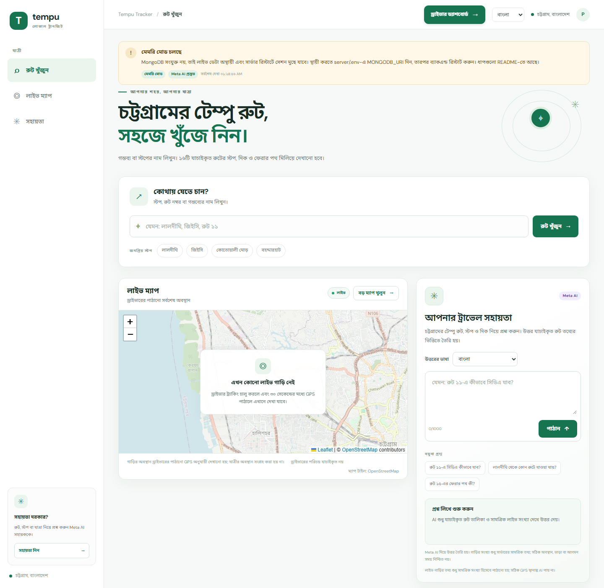
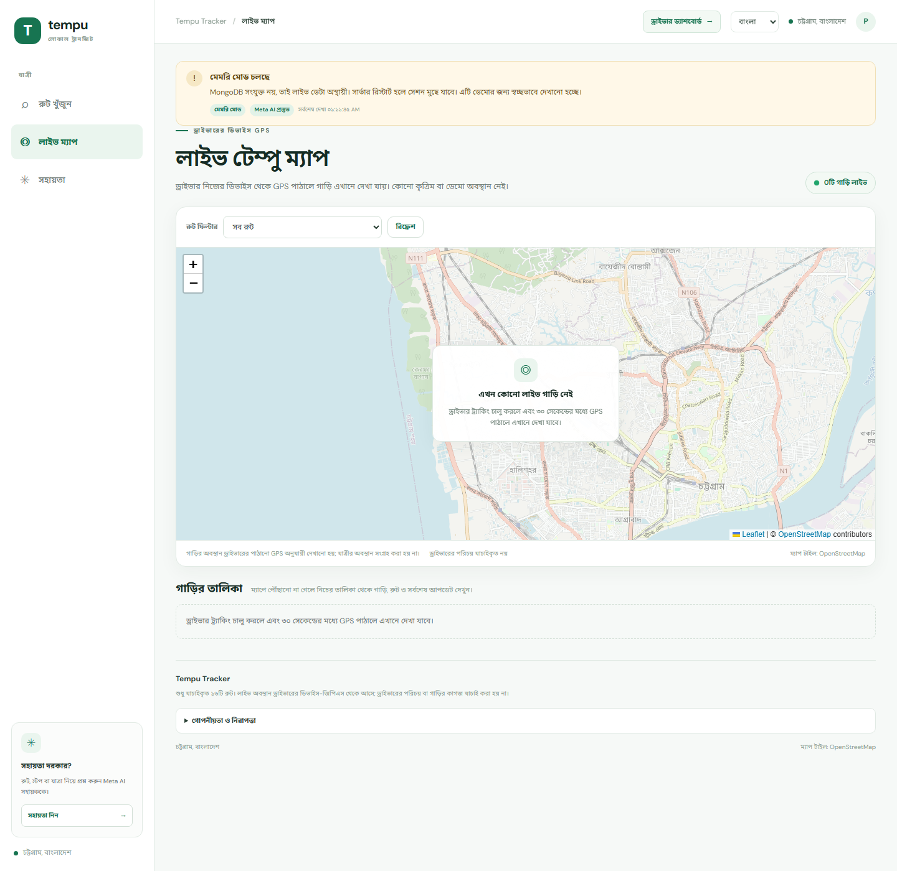
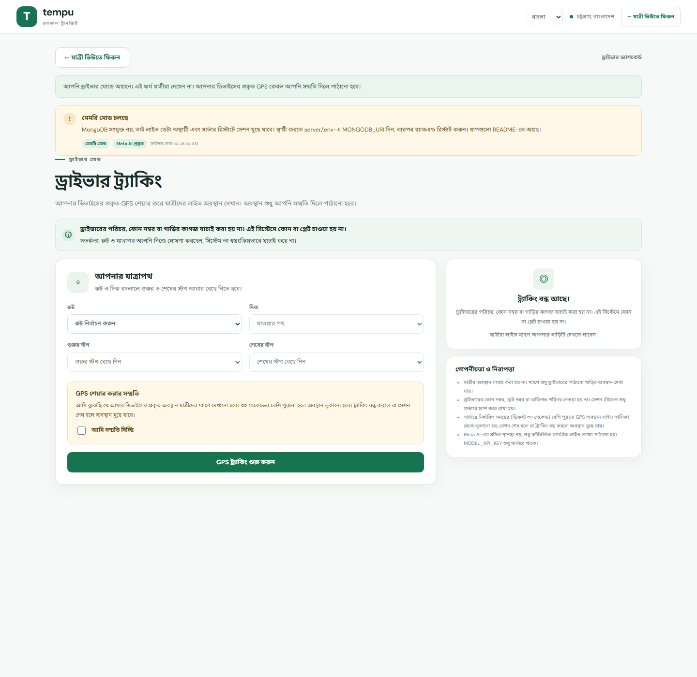
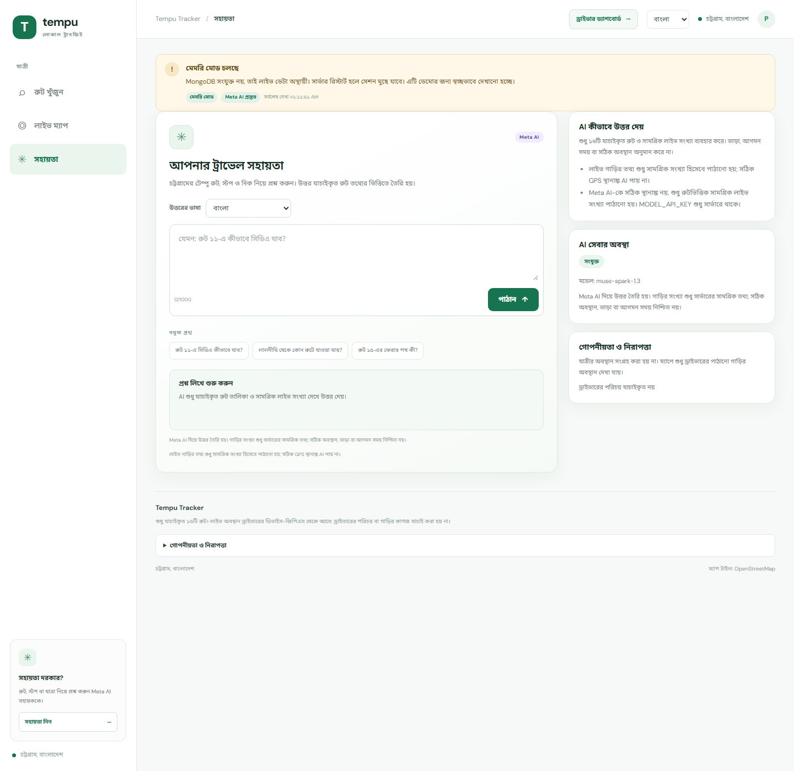
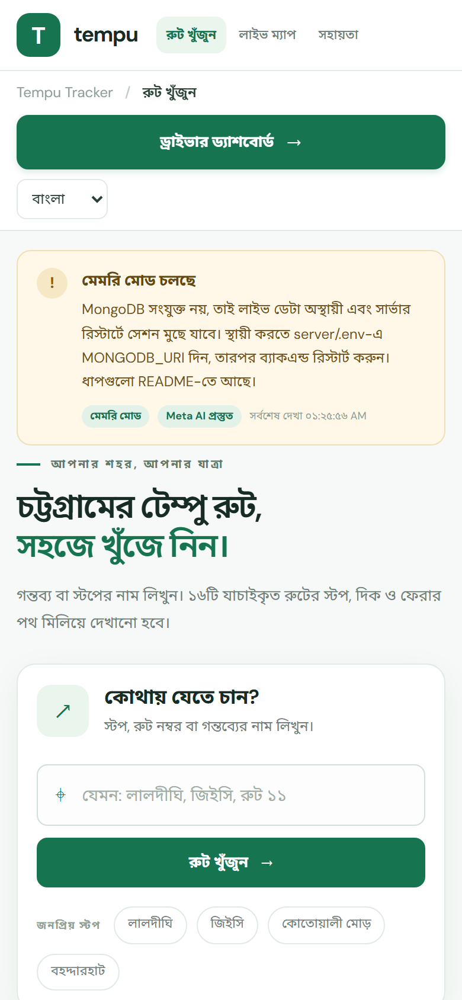
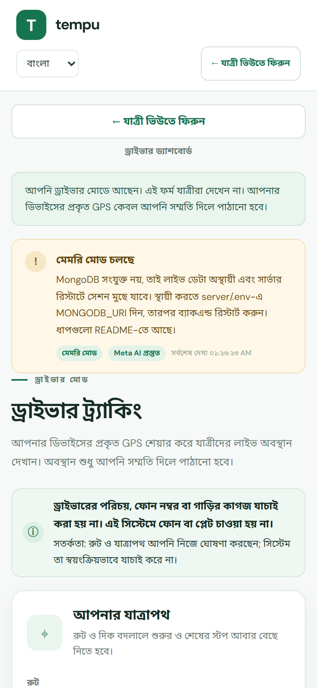

# Tempu Tracker

**Chattogram's verified tempu routes, driver-shared live GPS, and a Meta AI travel assistant.**

Tempu Tracker is a Bangla-first web app built for the Meta AI Developer Hackathon 2026. It combines a canonical dataset of 16 Chattogram tempu routes with genuine browser/device GPS sharing by drivers and a route-grounded AI assistant.

> This is a working hackathon prototype, not a production transport service. Driver identity and vehicle documents are **not** verified. Live positions exist only while a driver deliberately shares device GPS. There is no fake movement or demo vehicle in the live map.



## What is implemented

- **16 verified routes** (`01`–`08`, `10`–`17`) with exact stop names and order. Route `09` is intentionally absent.
- **Outbound and return directions**, including explicit returns and `একই পথে` reversal. Route 15's return tail is marked **partially inferred** and `আবদুস সাত্তার রোড` is treated as a via-road, not a stop.
- **Deterministic route search** by stop, route number, or route name, with Bangla digit normalization and distinct `একে খান মোড়` / `একে খান গেট` handling.
- **Driver flow**: route → direction → valid partial start/end, explicit GPS consent, one genuine browser GPS fix to start, then a throttled `watchPosition` stream.
- **Multi-vehicle live map**: separate sessions, route filter, server timestamps, stale filtering, live/empty/loading/offline/error states, accessible vehicle list.
- **MongoDB persistence when configured**: official driver, JSON schema validation, unique indexes, TTL expiry, and session isolation. Without a URI, the app runs in an explicitly labelled non-persistent memory mode.
- **Meta AI assistant**: backend-only `MODEL_API_KEY`, verified `https://api.meta.ai/v1`, model `muse-spark-1.2-contributor` (pinned in `server/config.ts`), grounded prompt using verified routes and aggregate live counts only. AI and tracking fail independently.
- **Privacy controls**: no phone, plate, driver identity, or passenger location is collected. Session tokens are returned once, stored hashed, sent only in a Bearer header, and removed on stop/expiry.
- **Bangla/English UI**, experimental Chittagonian AI answer option (with standard Bangla fallback), responsive layout, keyboard focus, skip link, reduced-motion support.
- **Two clear interfaces**: a passenger dashboard (search, embedded live map, AI assistant card, route directory) and a separate full-screen driver interface. The driver view is never mixed into passenger navigation.
- **Always-visible driver access**: the **ড্রাইভার ড্যাশবোর্ড** button stays in the passenger header on Explore, Live map, and Assistant views. On mobile it becomes a full-width button. The driver interface has an obvious **যাত্রী ভিউতে ফিরুন** action in both the header and main content.
- **Automated tests** for routes, journeys, GPS validation, session isolation, store/AI outages, AI failure mapping, privacy, search, freshness, and the frontend API client.

## Screens

| Live map | Driver tracking | Assistant |
| --- | --- | --- |
|  |  |  |

| Mobile passenger dashboard | Mobile driver interface |
| --- | --- |
|  |  |

## Quick start

### Prerequisites

- Node.js **22+** (tested with Node 24.18.0)
- npm
- Optional: a MongoDB Atlas Free connection string
- Optional: a Meta Model API key with access to `muse-spark-1.2-contributor`

### 1. Install

```powershell
cd "E:\Meta Hackathon 2026\tempu-tracker"
npm install
cd server
npm install
cd ..
```

### 2. Configure the backend

```powershell
Copy-Item server/.env.example server/.env
```

Edit `server/.env`:

```dotenv
PORT=3001
MONGODB_URI=              # optional; leave blank for labelled memory mode
MONGODB_DB_NAME=tempu_tracker
MODEL_API_KEY=            # backend only; never put this in a VITE_* variable
META_BASE_URL=https://api.meta.ai/v1
META_MODEL=muse-spark-1.2-contributor
```

`server/.env` is ignored by Git. Never commit it or paste its contents into a public issue.

### 3. Optional frontend environment

For local development the frontend calls relative `/api` URLs and Vite proxies them to `http://localhost:3001`. No `.env` is required.

For a separately hosted backend:

```powershell
Copy-Item .env.example .env
```

Set `VITE_API_BASE_URL=https://your-api.example.com` and rebuild. `VITE_*` values are public; never put a secret there.

### 4. Run

Terminal 1:

```powershell
cd server
npm run dev
```

Terminal 2:

```powershell
npm run dev
```

Open `http://localhost:5173`.

Useful deep links:

- Passenger dashboard (default): `http://localhost:5173/#/explore`
- Full live map: `http://localhost:5173/#/map`
- Assistant: `http://localhost:5173/#/assistant`
- Driver interface: `http://localhost:5173/#/driver`

The passenger dashboard and the driver interface are separate top-level modes. The driver interface opens from the **ড্রাইভার ড্যাশবোর্ড** button in the passenger top bar and has its own back action.

The driver's **Open live map in a new tab** button keeps the driver tab alive so the GPS watch is not unmounted.

### 5. Verify Meta access without inference

```powershell
cd server
npm run verify:meta
```

This performs an authenticated model-list request only and does **not** generate an answer. To run one short inference call (may consume provider credits):

```powershell
npm run verify:meta -- --infer
```

Only do this with approval to spend provider credits.

## Data modes

| Condition | Mode | Behaviour |
| --- | --- | --- |
| `MONGODB_URI` set and reachable | `mongodb` | Persistent sessions, indexes, TTL retention |
| `MONGODB_URI` blank | `memory` | Non-persistent; clearly labelled in UI and health |
| MongoDB configured but unreachable, `MONGODB_REQUIRED=false` | `memory-fallback` | Non-persistent fallback; clearly labelled |
| MongoDB required and unavailable | `unavailable` | Tracking endpoints return `503`; AI can still work |

The frontend reads `/api/health` and shows a memory-mode or database-down banner. It does not present memory data as durable.

### MongoDB persistence setup

The current local `server/.env` has no `MONGODB_URI`, so the app truthfully runs in memory mode. To enable persistence:

1. Create a **MongoDB Atlas Free** cluster (or use another MongoDB deployment).
2. In **Database Access**, create a database user with a strong password.
3. In **Network Access**, allow your current public IP (and your deployment's egress IP later).
4. Copy the connection string from Atlas.
5. Add it to `server/.env` locally:
   ```dotenv
   MONGODB_URI=mongodb+srv://<user>:<password>@<cluster>.mongodb.net/?retryWrites=true&w=majority
   MONGODB_DB_NAME=tempu_tracker
   MONGODB_REQUIRED=false
   ```
6. Restart the backend and check `http://localhost:3001/api/health`. A successful setup reports:
   ```json
   "database": { "configured": true, "connected": true, "mode": "mongodb", "persistent": true }
   ```
7. Start a driver session, then verify persistence by updating its location, restarting the backend, and confirming the active vehicle is still returned (if it is still inside the 30-second freshness window). The integration test requires a **test-only** URI:
   ```powershell
   $env:MONGODB_URI_TEST="mongodb+srv://<test-user>:<password>@<test-cluster>/..."
   $env:MONGODB_DB_NAME_TEST="tempu_tracker_test"
   cd server
   npm test
   ```

Never commit `server/.env` or paste the connection string into an issue. If MongoDB is blank or unreachable, the UI keeps showing an explicit memory / memory-fallback warning.

## API

| Method | Path | Purpose |
| --- | --- | --- |
| `GET` | `/api/health` | Separate database and AI health, no secrets |
| `GET` | `/api/health/ready` | Readiness (`503` only when tracking is unavailable) |
| `GET` | `/api/tracking/active?routeNumber=01` | Fresh public vehicle positions and stale count |
| `POST` | `/api/tracking/start` | Validate journey, consent, initial GPS; create session |
| `POST` | `/api/tracking/location` | Update one session using `Authorization: Bearer <token>` |
| `POST` | `/api/tracking/stop` | Delete the session (idempotent `204`) |
| `POST` | `/api/ai-test` | Route-grounded Meta AI answer |

All API responses use structured error codes such as `INVALID_JOURNEY`, `CONSENT_REQUIRED`, `UNAUTHORIZED_SESSION`, `UPDATE_TOO_FREQUENT`, `TRACKING_STORE_UNAVAILABLE`, and `AI_NOT_CONFIGURED`.

## Tests and checks

```powershell
# Frontend
npm test
npm run build
npm run lint

# Backend
cd server
npm run typecheck
npm test
```

Current local result (29 Oct 2026):

- Frontend: **17/17 tests passed**, build passed, lint clean.
- Backend: **55 tests, 54 passed, 1 skipped** (MongoDB integration requires `MONGODB_URI_TEST`).
- Driver access: passenger → driver and driver → passenger navigation verified in headless Chrome at desktop and 390 px mobile widths; UI GPS start/update/stop flow verified with Chrome geolocation emulation.
- Database: **memory mode** because no `MONGODB_URI` is configured; persistence remains untested until a real Atlas test URI is provided.
- Dependency audit: **0 vulnerabilities** after updating Capacitor CLI tooling.
- Meta model listing: authenticated, 9 models visible, requested `muse-spark-1.3` present; **no inference call made** during automated checks.

See [TEST_REPORT.md](docs/TEST_REPORT.md) for exact output and untested areas.

## Documentation

- [Architecture](docs/ARCHITECTURE.md)
- [Privacy and security](docs/PRIVACY_AND_SECURITY.md)
- [Test report](docs/TEST_REPORT.md)
- [Requirements checklist](docs/REQUIREMENTS_CHECKLIST.md)
- [Demo script](docs/DEMO_SCRIPT.md)
- [Known limitations](docs/KNOWN_LIMITATIONS.md)

## Important limitations

- The 16-route dataset comes from the supplied hackathon route list; it has not been independently field-verified. Route 15's return tail awaits owner confirmation.
- Driver identity, phone number, and vehicle documents are not verified. Route and journey are self-declared.
- Browser GPS can be spoofed by a determined user; the server validates format, range, rate, and session isolation, not physical presence.
- No fare, ETA, passenger account, demand insight, or background tracking.
- MongoDB integration and real Meta inference are not covered by the default automated test run.
- Android APK build is not verified in this environment (Java/`ANDROID_HOME` missing). Location and internet permissions have been added to the manifest.

## License

No license has been declared yet. Add one only after the hackathon's IP and submission rules are confirmed.
